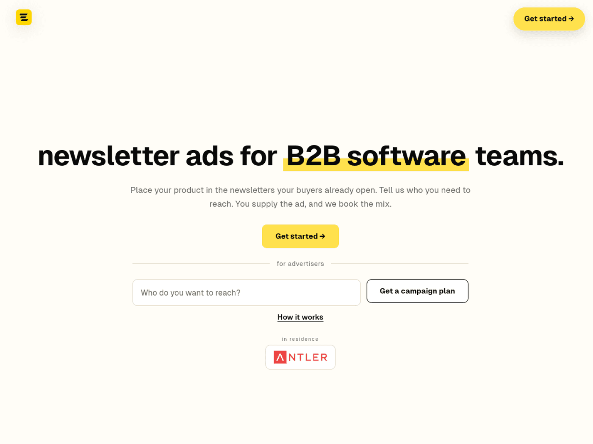
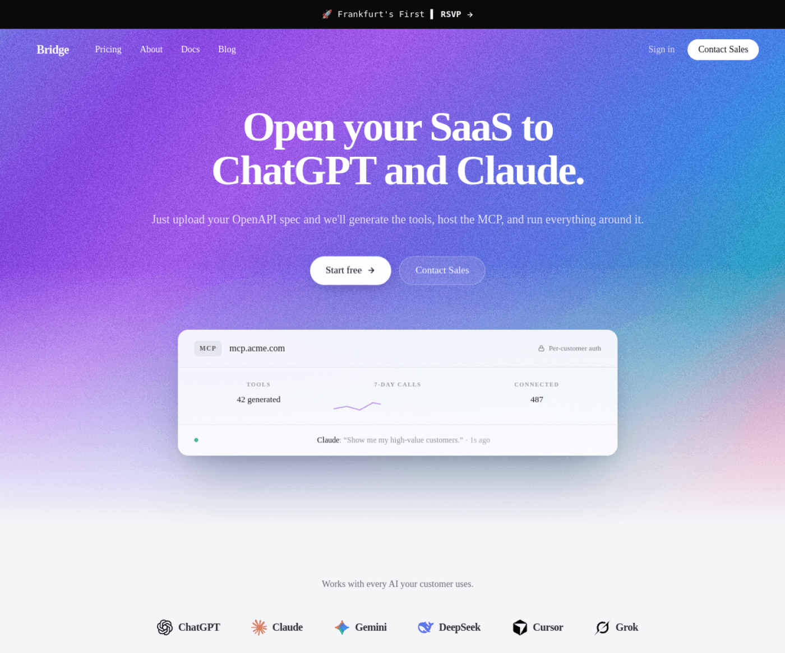
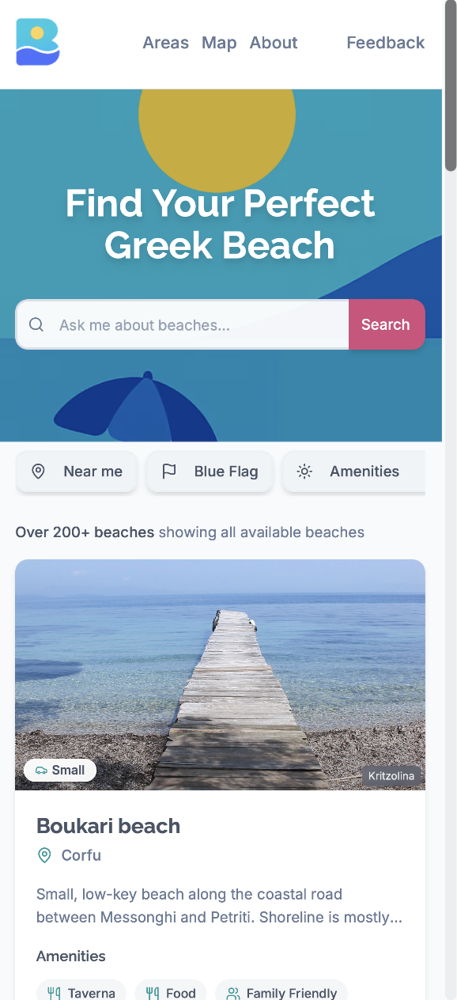
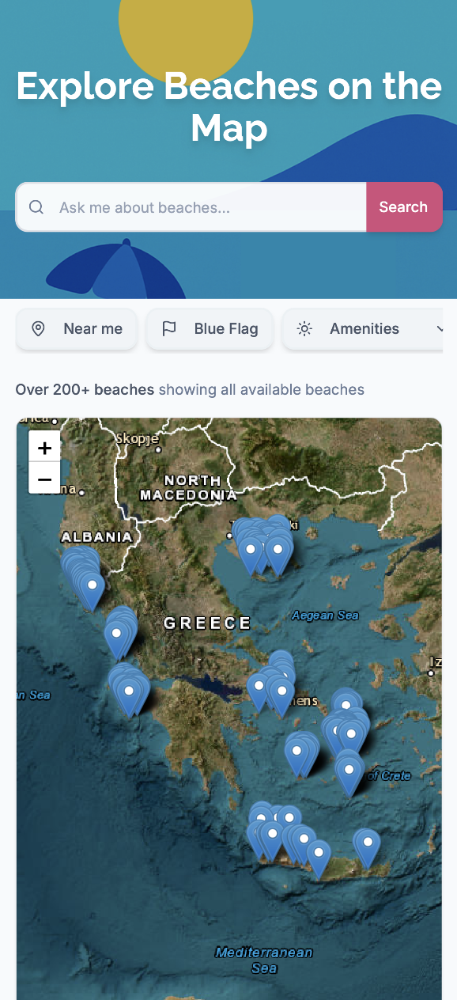
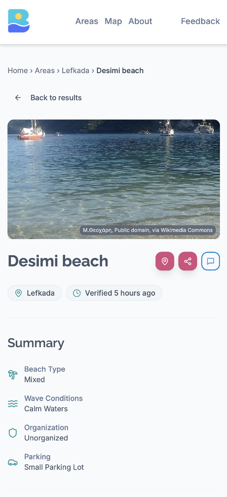
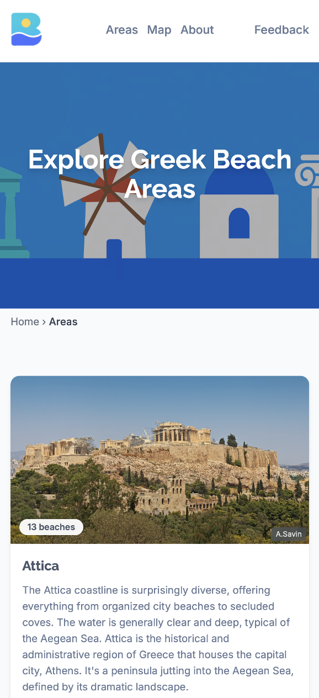

# Tomer Liran

**AI Full-Stack Engineer** · Node.js · TypeScript · PostgreSQL · LLMs in production

[LinkedIn](https://linkedin.com/in/tomer-liran) · [X](https://x.com/tomerlrn) · [Email](mailto:lirtomer@gmail.com) · Berlin

---

Full-stack engineer with six years shipping production software — remote since 2021, the last year building AI products as a founder. I clarify the problem and design the architecture; AI implements; I verify every change is production-ready.

Currently an **Entrepreneur in Residence at [Antler](https://www.antler.co/)** in Berlin (selected from ~10,000 applicants).

### Selected work

<table>
  <tr>
    <td width="50%" valign="top">
      <h3><a href="https://beachesofgreece.com">Beaches of Greece</a></h3>
      
<strong>Founder</strong> · Aug 2025 – Present

      
Offline DeepSeek enrichment over OpenStreetMap for 900+ beaches. Free-text search parses into structured filters — LLMs stay off the request path, so every query is instant and free. Rebuilt as a statically generated React/Vite SPA (~600 pages); Google clicks <strong>113 → 1,995</strong> in three months.

      
<code>React</code> <code>Vite</code> <code>TypeScript</code> <code>DeepSeek</code> <code>OSM</code>

    </td>
    <td width="50%" valign="top">
      <h3><a href="https://getemil.ai">Emil</a></h3>
      
<strong>Co-Founder</strong> · Sep 2026 – Oct 2026

      
B2B newsletter sponsorship platform, built solo. LLM features for research briefs, outreach drafts, creator ranking, and an onboarding assistant. Benchmarked models per task; Zod + JSON mode + deterministic fallbacks for reliable output. Onboarded <strong>50 creators / 1M combined reach</strong>.

      
<code>TypeScript</code> <code>Supabase</code> <code>Postgres</code> <code>gpt-4.1-mini</code> <code>Apify</code>

    </td>
  </tr>
  <tr>
    <td width="50%" valign="top">
      <h3>Bridge</h3>
      
<strong>CTO & Co-Founder</strong> · Apr 2026 – Aug 2026

      
Turned a company's OpenAPI spec into an access-controlled MCP server — so CS teams run exports and database actions through chat, with Zod validation, evals, retries, and fallbacks. Shipped frontend, backend, and infra with one co-founder in two months.

      
<code>MCP</code> <code>OpenAPI</code> <code>Zod</code> <code>LLM evals</code> <code>TypeScript</code>

    </td>
    <td width="50%" valign="top">
      <h3>Sensory-Minds</h3>
      
<strong>Web Engineer</strong> · Oct 2022 – Aug 2025

      
Store, games, and promotions for a B2C loyalty platform with <strong>~2M active users</strong>. Designed RBAC that cut developer dependency by ~75%. Remote in a 30-person team from requirements to production.

      
<code>Node.js</code> <code>React</code> <code>MongoDB</code> <code>PostgreSQL</code> <code>Phaser</code>

    </td>
  </tr>
</table>

### Emil · [getemil.ai](https://getemil.ai)

<table>
  <tr>
    <td width="58%" valign="top">
      
    </td>
    <td width="42%" valign="top">
      
    </td>
  </tr>
</table>

### Bridge — OpenAPI → hosted MCP

### Beaches of Greece · [beachesofgreece.com](https://beachesofgreece.com)

<table>
  <tr>
    <td width="33%"></td>
    <td width="33%"></td>
    <td width="33%"></td>
  </tr>
</table>

### Stack

| | |
|---|---|
| **Backend** | Node.js, TypeScript, Express, PostgreSQL, Supabase, MongoDB, Prisma, Drizzle, GraphQL, REST |
| **AI** | Claude / OpenAI / DeepSeek APIs · agents · MCP · structured outputs (JSON mode, Zod) · evals · retries & fallbacks · Ollama |
| **AI tools** | Claude Code, Cursor, Codex — daily |
| **Frontend** | React, Next.js, TanStack Start, Vite, Tailwind |
| **Ops** | Docker, Cloudflare, custom CI/CD, Jest |

### Open source

- [**Bridge CLI**](https://github.com/usebridgeai/cli) — OpenAPI → MCP server generation with managed OAuth 2.1
- [**Grind**](https://github.com/tomer-liran/grind) — open-source workout PWA; fork it and edit one file to match your gym

### Earlier

Led an internal ticketing platform at Noema Consulting (~50% faster support resolution). Before that: UBITECH, Technor Engineering (~20k smart controllers), and computer & network engineer in the Hellenic Navy. **BSc (Hons) Computer Science**, Aberystwyth University.

---

English · Greek · Hebrew &nbsp;·&nbsp; Always happy to talk production AI, MCP, or shipping LLM features that stay reliable.

